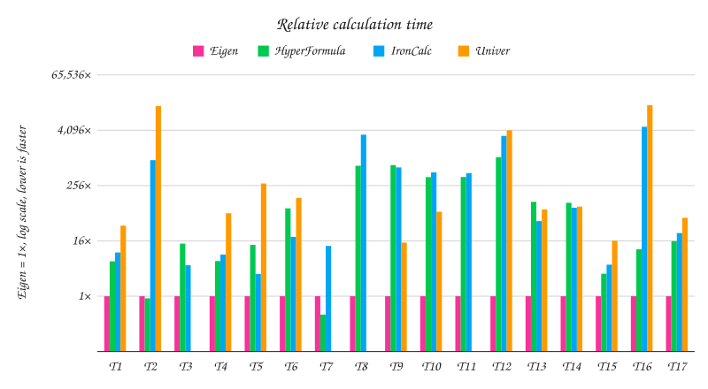

# eigen|formula⟩ compared with HyperFormula, IronCalc and Univer

This folder compares eigen|formula⟩, Eigen's formula engine (`@workspace/formula`), with three other formula engines that run in JavaScript: [HyperFormula](https://hyperformula.handsontable.com/), [IronCalc](https://www.ironcalc.com/) and [Univer](https://univer.ai/). IronCalc is written in Rust and runs as WebAssembly. Univer is a toolkit for office documents, and its formula engine is one of its parts. It measures three things, in this order of importance: speed, correctness and coverage. [formulajs](https://formulajs.info) is not compared: it is a library of functions, not an engine, so it reads no formula text, holds no cells and recalculates nothing; it implements 406 of Excel's 524 functions. The numbers below come from one run on 2026-11-14. A script wrote them into `results.json`, a second drew the chart from that file, and a third wrote this README from that file and from `notes.md`. Apart from that one count, no number here is typed by hand.

```sh
cd packages/formula/benchmark
bun install                  # installs the other engines into this folder only, at the versions in its package.json
bun run.ts --quick           # a first look in a few minutes at reduced sizes; prints its tables, changes no file here

# After a change to the engine: measure ours again, keep the other engines' figures, about five minutes.
bun run.ts --engines ours    # writes results.json
bun ../../../apps/api/src/scripts/benchmark-charts.ts   # draws speed.svg from results.json
bun readme.ts                # writes this README from results.json and notes.md

# After a new version of another engine, and before a release: every engine, overnight.
bun run.ts                   # about three hours; then the chart and README steps above
```

A run with `--engines ours` measures speed on both runtimes and correctness for eigen|formula⟩ only. It keeps the speed and correctness figures of the other engines from `results.json`, with the version and date they were measured with, works out every ratio again, and this README then says which figures were kept from which run. It refuses to run when `results.json` comes from another machine or another version of Bun or Node, since a ratio across two machines measures the machines. It warns when another engine's installed version is not the one its figures came from: run that engine again with `--engines ours,<engine>`.

`bun run.ts --help` lists the options. A quick run divides every count by 10 (100,000 rows become 10,000), takes 3 rounds of one run each on Bun only, so no run warms the runtime up first, and judges every 100th recorded row. Its numbers are for a first look and are not the ones below; ratios at a tenth of the size can differ from the full ones, since index and setup costs do not grow in a straight line with the size.

`bun rows.ts <oracle folder>` rebuilds `excel-rows.jsonl`, the file of Excel's recorded answers, from the local recording files. It reuses the oracle's own reader in `scripts/oracle-rows.ts`. After a change to the recordings, run `bun rows.ts <oracle folder>`, then the full run and the chart and README steps.

## The results in three lines

- Speed on Bun: eigen|formula⟩ was faster than HyperFormula in 15 of the 17 workloads both ran, where HyperFormula took from 0.40× to 1,060× of our time; HyperFormula was as fast or faster in: edit a cell with 3 dependents; running total down 20,000 rows. eigen|formula⟩ was faster than IronCalc in 17 of the 17 workloads both ran, where IronCalc took from 3.0× to 4,865× of our time. eigen|formula⟩ was faster than Univer in 17 of the 17 workloads both ran, where Univer took from 15× to 14,320× of our time.
- Correctness: of 17,584 answers recorded in Excel, eigen|formula⟩ gave Excel's answer on 92.0%, HyperFormula on 55.4%, IronCalc on 74.3% and Univer on 82.6%.
- Coverage: of Excel's 524 functions, eigen|formula⟩ has 219, HyperFormula 384, IronCalc 492 and Univer 495.

## Speed at a glance



Each bar is an engine's median time on one workload divided by ours, on a log scale: every gridline is 16 times the one below it, starting at 1×, and a bar below the 1× line means that engine was faster than us. Lower is faster. T17 compares memory, not time. The chart and its key show the run on Bun only; the tables below have Node too. Univer has no bar at T3, T7, T8 and T11: one of its runs took more than two minutes at the full size, so it ran again at a tenth of the size, and the key gives its ratio there.

| | workload | eigen\|formula⟩ | HyperFormula | IronCalc | Univer |
|---|---|---:|---:|---:|---:|
| T1 | load and compute 300,000 formulas | 1.0× | 5.7× | 8.9× | 34× |
| T2 | edit a cell with 3 dependents | 1.0× | 0.90× | 913× | 13,788× |
| T3 | edit a cell read by 100,000 formulas | 1.0× | 14× | 4.7× | 1,077× at 1/10 size |
| T4 | load a chain of 100,000 formulas | 1.0× | 5.8× | 8.1× | 64× |
| T5 | edit the start of a chain of 100,000 | 1.0× | 13× | 3.0× | 284× |
| T6 | 200 sums of 90,000 cells each | 1.0× | 82× | 20× | 138× |
| T7 | running total down 20,000 rows | 1.0× | 0.40× | 12× | 105× at 1/10 size |
| T8 | exact VLOOKUP, 2,000 over 100,000 rows | 1.0× | 690× | 3,274× | 382× at 1/10 size |
| T9 | approximate VLOOKUP, 2,000 over 100,000 rows | 1.0× | 714× | 635× | 15× |
| T10 | exact MATCH, 2,000 over 100,000 rows | 1.0× | 390× | 495× | 69× |
| T11 | approximate MATCH, 2,000 over 100,000 rows | 1.0× | 392× | 477× | 689× at 1/10 size |
| T12 | exact XLOOKUP, 2,000 over 100,000 rows | 1.0× | 1,060× | 3,078× | 4,071× |
| T13 | SUMIFS, 200 over 100,000 rows | 1.0× | 113× | 43× | 77× |
| T14 | COUNTIFS, 200 over 100,000 rows | 1.0× | 108× | 84× | 89× |
| T15 | text functions on 100,000 rows | 1.0× | 3.1× | 4.9× | 16× |
| T16 | insert a row near the top | 1.0× | 10× | 4,865× | 14,320× |
| T17 | memory after loading 300,000 formulas | 1.0× | 16× | 24× | 51× |

## Words used in this README

- A **formula** is a cell's text that starts with `=` and computes a value, such as `=A1*2`.
- A **cell reference** is the name of a cell inside a formula, such as `A1`. A **range** is a block of cells, such as `A1:A100`.
- A **dependency** is a link from a formula to a cell it reads. When `B1` holds `=A1*2`, `B1` depends on `A1`, and `B1` is a **dependent** of `A1`.
- **Recalculation** is computing formulas again after a cell changes. A good engine computes only the dependents of the changed cell.
- A **lookup** searches a column for a value and returns something about the row where it found it, as `VLOOKUP`, `MATCH` and `XLOOKUP` do. An exact lookup wants the same value. An approximate lookup wants the largest value that is not above the key, in sorted data.
- A **volatile function** gives a new value every time it is computed, such as `NOW()` or `RAND()`.
- A formula **spills** when it gives a whole array of values and the values fill the cells below and to the right of it.
- **WebAssembly** is a compact program format that JavaScript runtimes run at close to the speed of native code. A call from JavaScript into it, or a value passed across, has a small cost of its own.

## How to read the tables

Each speed row is one workload. A workload is a workbook built in code, so anyone can run it again with nothing but the repo. A cell shows two times in milliseconds: the fastest round and the median round, as `fastest / median`. A cell with fewer rounds than its table says so, such as "(2 rounds)". Lower is better. Each runtime has one table with every engine, and the ratio column after an engine divides its median by ours. A ratio of 5× means the other engine took five times as long as eigen|formula⟩. A ratio below 1× means the other engine was faster. The memory row shows megabytes instead of times, and its ratio works the same way.

"not supported" means the engine cannot run that workload. "wrong values" means the engine ran it, but its values were not the same as ours, so its time does not count. "too slow" means one run of the engine took more than two minutes. Its time is then not taken again in later rounds, and the workload comes back in a row of its own at a tenth of the size, marked "a tenth of the size for" that engine, run only by that engine and eigen|formula⟩. Times at the two sizes are never compared or scaled to each other.

A second table per runtime shows where the time goes. For each engine, it shows the median time of the load (or of the edit) on its own, then the median time of the whole run, as `step of whole`. The rest is the engine's own recalculation call. HyperFormula computes during its load, so for it the step is nearly the whole time. IronCalc computes only when it is asked to, so for it the step is the cost of putting the cells in, across the WebAssembly boundary, and the rest is its computing.

In the correctness tables, a row is one formula that a person typed into Excel for the web, with the answer Excel showed.

## Speed

Every engine runs each workload in a fresh process of its own, and never two processes at the same time. In each process the engine runs the workload up to three times, each time on a fresh engine, and the fastest run counts. The first run warms up the runtime. A process stops repeating after 20 seconds of runs, so a slow engine is timed fewer times in a process. There are several rounds, and each round starts all engines again, in a changing order, so a slower moment of the machine hits every engine alike. An engine whose first run of a workload takes longer than 5 seconds gets at most 2 rounds of it. Such a run moves only a few percent between rounds, and five rounds of the longest ones would take most of a full run. The second round still shows whether the first one was disturbed. Before each run the benchmark waits until the 1-minute load of the machine is low, and a run during which the load rose above that limit is thrown away and taken again. A run longer than a minute is kept, since by then the load mostly shows the run itself.

A workload without an edit measures the load: the engine gets the cells, reads the formulas and computes them all. HyperFormula computes every formula while it loads, so the load and the first full computation cannot be measured apart; the time is the two together for every engine. A workload with an edit loads first without the clock running, then measures the edit and the recalculation after it.

Before a time counts, the run checks the values. Each engine reports the values of a sample of cells after the workload, and they must match ours at 10 significant digits. We use 10 digits because HyperFormula rounds the numbers it gives out to 10 digits by default.

IronCalc gets every cell through its `setUserInput` call, one cell at a time, with its automatic evaluation paused, and then computes the whole workbook with one `evaluate` call. Univer gets the whole workbook as one snapshot, a single object that holds every sheet and cell. It computes its formulas on its own schedule after a change, not inside the call that made the change, so the run waits for its documented signal that the results are in place (`onCalculationResultApplied`), and the time includes that wait.

The workloads:

- **load and compute 300,000 formulas.** 100,000 rows, each with two numbers and three formulas (arithmetic, IF, ROUND), loaded and computed.
- **edit a cell with 3 dependents.** In that workbook, one number in row 50,001 changes, and the three formulas on its row recompute.
- **edit a cell read by 100,000 formulas.** Cell A1 is read by 100,000 formulas (=B1*$A$1+1 and so on); A1 changes and every formula recomputes. This is a full recalculation.
- **load a chain of 100,000 formulas.** A1 is 1 and each cell below adds 1 to the cell above it (=A1+1, =A2+1, ...), 100,000 cells deep.
- **edit the start of a chain of 100,000.** In that chain, A1 changes, so all 100,000 cells below it recompute in order.
- **200 sums of 90,000 cells each.** 200 formulas =SUM(A1:A90000), =SUM(A2:A90001) and so on, over 100,000 numbers.
- **running total down 20,000 rows.** Each of 20,000 rows sums everything above it and itself: =SUM($A$1:A1), =SUM($A$1:A2) and so on.
- **exact VLOOKUP, 2,000 over 100,000 rows.** 2,000 formulas =VLOOKUP(E1,$A$1:$B$100000,2,FALSE) over 100,000 keys in no order.
- **approximate VLOOKUP, 2,000 over 100,000 rows.** 2,000 formulas =VLOOKUP(E1,$A$1:$B$100000,2,TRUE) over 100,000 sorted keys; each key falls between two.
- **exact MATCH, 2,000 over 100,000 rows.** 2,000 formulas =MATCH(E1,$A$1:$A$100000,0) over 100,000 keys in no order.
- **approximate MATCH, 2,000 over 100,000 rows.** 2,000 formulas =MATCH(E1,$A$1:$A$100000,1) over 100,000 sorted keys.
- **exact XLOOKUP, 2,000 over 100,000 rows.** 2,000 formulas =XLOOKUP(E1,$A$1:$A$100000,$B$1:$B$100000) over 100,000 keys in no order.
- **SUMIFS, 200 over 100,000 rows.** 200 formulas =SUMIFS($A$1:$A$100000,$B$1:$B$100000,E1,$C$1:$C$100000,F1), each with its own pair of criteria such as "k3" and ">37".
- **COUNTIFS, 200 over 100,000 rows.** 200 formulas =COUNTIFS($B$1:$B$100000,E1,$C$1:$C$100000,F1) on the same data.
- **text functions on 100,000 rows.** 100,000 formulas =UPPER(LEFT(A1,6))&"-"&LEN(TRIM(A1))&"-"&SUBSTITUTE(A1,"a","o") over short texts.
- **insert a row near the top.** In the workbook of 300,000 formulas, one row is inserted above row 2, so every formula below it moves and its references change.
- **memory after loading 300,000 formulas.** The memory the engine holds after the load and first compute of that workbook, in MB.

### On Bun

Bun 1.4.4: 5 rounds, at most 3 runs in each process. The load averages over 1, 5 and 15 minutes were 4.90 5.40 4.15 when the run started, before it waited for a quiet machine, and 3.51 2.80 2.88 at its end; the highest 1-minute load seen after a kept run was 8.69, and 3 runs were taken again because the machine got busy during them. The run took 5,218 seconds.

| workload | eigen\|formula⟩ | HyperFormula | ratio | IronCalc | ratio | Univer | ratio |
|---|---|---|---|---|---|---|---|
| load and compute 300,000 formulas | 282.2 / 287.6 | 1,625 / 1,651 | 5.7× | 2,559 / 2,573 | 8.9× | 9,787 / 9,893 | 34× |
| edit a cell with 3 dependents | 0.27 / 0.28 | 0.24 / 0.25 | 0.90× | 251.7 / 253.6 | 913× | 3,781 / 3,830 | 13,788× |
| edit a cell read by 100,000 formulas | 10.3 / 10.9 | 149.8 / 151.9 | 14× | 48.7 / 51.5 | 4.7× | too slow: one run took 274 s; see the row at a tenth of the size |  |
| load a chain of 100,000 formulas | 48.9 / 49.3 | 280.5 / 287.0 | 5.8× | 394.8 / 397.6 | 8.1× | 3,133 / 3,147 | 64× |
| edit the start of a chain of 100,000 | 10.8 / 10.8 | 139.6 / 140.6 | 13× | 31.9 / 32.7 | 3.0× | 3,026 / 3,061 | 284× |
| 200 sums of 90,000 cells each | 34.3 / 36.1 | 2,933 / 2,946 | 82× | 703.6 / 705.5 | 20× | 4,951 / 4,972 | 138× |
| running total down 20,000 rows | 295.4 / 295.6 | 114.4 / 117.7 | 0.40× | 3,670 / 3,674 | 12× | too slow: one run took 150 s; see the row at a tenth of the size |  |
| exact VLOOKUP, 2,000 over 100,000 rows | 19.9 / 20.3 | 13,842 / 13,981 | 690× | 65,905 / 66,313 | 3,274× | too slow: one run took 172 s; see the row at a tenth of the size |  |
| approximate VLOOKUP, 2,000 over 100,000 rows | 19.3 / 19.5 | 13,834 / 13,946 | 714× | 12,250 / 12,412 | 635× | 286.0 / 287.8 | 15× |
| exact MATCH, 2,000 over 100,000 rows | 18.7 / 19.4 | 7,508 / 7,567 | 390× | 9,575 / 9,613 | 495× | 1,332 / 1,340 | 69× |
| approximate MATCH, 2,000 over 100,000 rows | 18.9 / 19.2 | 7,447 / 7,548 | 392× | 9,099 / 9,184 | 477× | too slow: one run took 276 s; see the row at a tenth of the size |  |
| exact XLOOKUP, 2,000 over 100,000 rows | 19.6 / 20.1 | 21,200 / 21,290 | 1,060× | 61,606 / 61,837 | 3,078× | 81,633 / 81,779 | 4,071× |
| SUMIFS, 200 over 100,000 rows | 61.5 / 61.6 | 6,944 / 6,967 | 113× | 2,619 / 2,650 | 43× | 4,725 / 4,764 | 77× |
| COUNTIFS, 200 over 100,000 rows | 50.6 / 53.0 | 5,681 / 5,721 | 108× | 4,437 / 4,464 | 84× | 4,481 / 4,729 | 89× |
| text functions on 100,000 rows | 391.4 / 392.3 | 1,190 / 1,212 | 3.1× | 1,879 / 1,906 | 4.9× | 6,248 / 6,337 | 16× |
| insert a row near the top | 0.79 / 0.99 | 9.92 / 10.4 | 10× | 4,827 / 4,841 | 4,865× | 14,042 / 14,248 | 14,320× |
| memory after loading 300,000 formulas | 9.7 MB | 152.6 MB | 16× | 229.0 MB | 24× | 491.6 MB | 51× |
| edit a cell read by 10,000 formulas, a tenth of the size for Univer | 1.16 / 1.26 | not run at this size |  | not run at this size |  | 1,348 / 1,354 | 1,077× |
| running total down 2,000 rows, a tenth of the size for Univer | 5.04 / 5.05 | not run at this size |  | not run at this size |  | 526.9 / 531.6 | 105× |
| exact VLOOKUP, 200 over 10,000 rows, a tenth of the size for Univer | 4.47 / 4.57 | not run at this size |  | not run at this size |  | 1,734 / 1,742 | 382× |
| approximate MATCH, 200 over 10,000 rows, a tenth of the size for Univer | 2.42 / 4.23 | not run at this size |  | not run at this size |  | 2,914 / 2,915 | 689× |

Where the time goes on Bun:

| workload | eigen\|formula⟩ | HyperFormula | IronCalc | Univer |
|---|---|---|---|---|
| load and compute 300,000 formulas | 249.8 of 287.6 | 1,651 of 1,651 | 2,311 of 2,573 | 243.0 of 9,893 |
| edit a cell with 3 dependents | 0.02 of 0.28 | 0.25 of 0.25 | 0.09 of 253.6 | 2.15 of 3,830 |
| edit a cell read by 100,000 formulas | 0.01 of 10.9 | 151.9 of 151.9 | 0.03 of 51.5 | too slow |
| load a chain of 100,000 formulas | 42.2 of 49.3 | 287.0 of 287.0 | 360.1 of 397.6 | 156.0 of 3,147 |
| edit the start of a chain of 100,000 | 0.01 of 10.8 | 140.6 of 140.6 | 0.04 of 32.7 | 0.39 of 3,061 |
| 200 sums of 90,000 cells each | 10.4 of 36.1 | 2,946 of 2,946 | 140.7 of 705.5 | 105.6 of 4,972 |
| running total down 20,000 rows | 12.2 of 295.6 | 117.7 of 117.7 | 99.1 of 3,674 | too slow |
| exact VLOOKUP, 2,000 over 100,000 rows | 14.1 of 20.3 | 13,981 of 13,981 | 311.7 of 66,313 | too slow |
| approximate VLOOKUP, 2,000 over 100,000 rows | 17.3 of 19.5 | 13,946 of 13,946 | 312.2 of 12,412 | 102.4 of 287.8 |
| exact MATCH, 2,000 over 100,000 rows | 14.1 of 19.4 | 7,567 of 7,567 | 290.0 of 9,613 | 117.9 of 1,340 |
| approximate MATCH, 2,000 over 100,000 rows | 17.0 of 19.2 | 7,548 of 7,548 | 287.5 of 9,184 | too slow |
| exact XLOOKUP, 2,000 over 100,000 rows | 14.1 of 20.1 | 21,290 of 21,290 | 313.3 of 61,837 | 123.0 of 81,779 |
| SUMIFS, 200 over 100,000 rows | 29.5 of 61.6 | 6,967 of 6,967 | 429.4 of 2,650 | 127.2 of 4,764 |
| COUNTIFS, 200 over 100,000 rows | 29.4 of 53.0 | 5,721 of 5,721 | 425.5 of 4,464 | 119.6 of 4,729 |
| text functions on 100,000 rows | 262.8 of 392.3 | 1,212 of 1,212 | 1,697 of 1,906 | 186.6 of 6,337 |
| insert a row near the top | 0.98 of 0.99 | 10.4 of 10.4 | 4,586 of 4,841 | 3,848 of 14,248 |
| edit a cell read by 10,000 formulas, a tenth of the size for Univer | 0.01 of 1.26 | not run | not run | 0.31 of 1,354 |
| running total down 2,000 rows, a tenth of the size for Univer | 1.35 of 5.05 | not run | not run | 28.4 of 531.6 |
| exact VLOOKUP, 200 over 10,000 rows, a tenth of the size for Univer | 3.84 of 4.57 | not run | not run | 34.3 of 1,742 |
| approximate MATCH, 200 over 10,000 rows, a tenth of the size for Univer | 3.63 of 4.23 | not run | not run | 33.6 of 2,915 |

### On Node

Node v24.15.0: 5 rounds, at most 3 runs in each process. The load averages over 1, 5 and 15 minutes were 3.51 2.80 2.88 when the run started, before it waited for a quiet machine, and 2.49 2.68 2.69 at its end; the highest 1-minute load seen after a kept run was 5.40, and 0 runs were taken again because the machine got busy during them. The run took 6,743 seconds.

| workload | eigen\|formula⟩ | HyperFormula | ratio | IronCalc | ratio | Univer | ratio |
|---|---|---|---|---|---|---|---|
| load and compute 300,000 formulas | 425.3 / 430.7 | 2,403 / 2,424 | 5.6× | 8,460 / 8,706 | 20× | 16,905 / 17,009 | 39× |
| edit a cell with 3 dependents | 0.40 / 0.40 | 0.20 / 0.21 | 0.51× | 322.7 / 323.5 | 802× | 6,766 / 6,809 | 16,876× |
| edit a cell read by 100,000 formulas | 13.4 / 13.5 | 124.1 / 127.1 | 9.4× | 59.5 / 61.1 | 4.5× | too slow: one run took 352 s; see the row at a tenth of the size |  |
| load a chain of 100,000 formulas | 53.0 / 57.2 | 363.0 / 365.0 | 6.4× | 456.3 / 493.2 | 8.6× | 4,872 / 4,904 | 86× |
| edit the start of a chain of 100,000 | 15.8 / 16.4 | 88.3 / 89.5 | 5.5× | 40.9 / 41.2 | 2.5× | 4,739 / 4,765 | 291× |
| 200 sums of 90,000 cells each | 43.4 / 49.1 | 2,823 / 2,858 | 58× | 865.8 / 876.7 | 18× | 13,822 / 13,917 | 284× |
| running total down 20,000 rows | 363.8 / 365.1 | 178.0 / 179.3 | 0.49× | 5,744 / 5,746 | 16× | failed: 40: 0x1042eabb4 node::Start(int, char**) [/Users/reinder/.nvm/versions/node/v24.15.0/bin/node] 41: 0x1844f0d7c start [/usr/lib/dyld] |  |
| exact VLOOKUP, 2,000 over 100,000 rows | 26.3 / 27.0 | 17,082 / 17,109 | 634× | 90,570 / 91,872 | 3,402× | too slow: one run took 175 s; see the row at a tenth of the size |  |
| approximate VLOOKUP, 2,000 over 100,000 rows | 19.6 / 23.7 | 17,352 / 17,694 | 746× | 15,437 / 15,579 | 657× | 379.9 / 386.3 | 16× |
| exact MATCH, 2,000 over 100,000 rows | 23.7 / 25.7 | 8,524 / 9,807 | 382× | 15,896 / 15,929 | 621× | 1,457 / 1,468 | 57× |
| approximate MATCH, 2,000 over 100,000 rows | 18.9 / 19.8 | 8,498 / 8,689 | 438× | 15,453 / 15,767 | 795× | too slow: one run took 285 s; see the row at a tenth of the size |  |
| exact XLOOKUP, 2,000 over 100,000 rows | 25.3 / 26.1 | 39,953 / 40,247 | 1,544× | 91,526 / 92,232 | 3,538× | 79,849 / 79,967 | 3,067× |
| SUMIFS, 200 over 100,000 rows | 72.4 / 73.6 | 12,227 / 12,956 | 176× | 3,035 / 3,042 | 41× | 9,364 / 9,678 | 131× |
| COUNTIFS, 200 over 100,000 rows | 65.1 / 67.2 | 9,789 / 9,937 | 148× | 6,217 / 6,238 | 93× | 8,829 / 8,931 | 133× |
| text functions on 100,000 rows | 535.2 / 548.8 | 2,292 / 2,313 | 4.2× | 3,760 / 3,874 | 7.1× | 12,510 / 12,593 | 23× |
| insert a row near the top | 0.78 / 0.91 | 16.0 / 16.4 | 18× | 6,358 / 6,363 | 6,997× | 34,867 / 38,671 | 42,521× |
| memory after loading 300,000 formulas | 9.1 MB | 219.4 MB | 24× | 225.4 MB | 25× | 514.4 MB | 56× |
| edit a cell read by 10,000 formulas, a tenth of the size for Univer | 1.42 / 1.43 | not run at this size |  | not run at this size |  | 2,552 / 2,573 | 1,802× |
| exact VLOOKUP, 200 over 10,000 rows, a tenth of the size for Univer | 5.90 / 6.38 | not run at this size |  | not run at this size |  | 1,772 / 1,824 | 286× |
| approximate MATCH, 200 over 10,000 rows, a tenth of the size for Univer | 6.44 / 6.62 | not run at this size |  | not run at this size |  | 3,055 / 3,058 | 462× |

Where the time goes on Node:

| workload | eigen\|formula⟩ | HyperFormula | IronCalc | Univer |
|---|---|---|---|---|
| load and compute 300,000 formulas | 369.4 of 430.7 | 2,424 of 2,424 | 8,223 of 8,706 | 253.6 of 17,009 |
| edit a cell with 3 dependents | 0.02 of 0.40 | 0.20 of 0.21 | 0.08 of 323.5 | 2.01 of 6,809 |
| edit a cell read by 100,000 formulas | 0.02 of 13.5 | 127.0 of 127.1 | 0.05 of 61.1 | too slow |
| load a chain of 100,000 formulas | 44.6 of 57.2 | 365.0 of 365.0 | 407.3 of 493.2 | 153.2 of 4,904 |
| edit the start of a chain of 100,000 | 0.01 of 16.4 | 89.5 of 89.5 | 0.05 of 41.2 | 0.34 of 4,765 |
| 200 sums of 90,000 cells each | 17.4 of 49.1 | 2,858 of 2,858 | 171.8 of 876.7 | 112.8 of 13,917 |
| running total down 20,000 rows | 15.9 of 365.1 | 179.3 of 179.3 | 122.5 of 5,746 | failed |
| exact VLOOKUP, 2,000 over 100,000 rows | 18.0 of 27.0 | 17,109 of 17,109 | 303.7 of 91,872 | too slow |
| approximate VLOOKUP, 2,000 over 100,000 rows | 21.0 of 23.7 | 17,694 of 17,694 | 304.4 of 15,579 | 115.4 of 386.3 |
| exact MATCH, 2,000 over 100,000 rows | 17.5 of 25.7 | 9,807 of 9,807 | 298.7 of 15,929 | 110.5 of 1,468 |
| approximate MATCH, 2,000 over 100,000 rows | 17.6 of 19.8 | 8,689 of 8,689 | 302.3 of 15,767 | too slow |
| exact XLOOKUP, 2,000 over 100,000 rows | 17.4 of 26.1 | 40,247 of 40,247 | 302.0 of 92,232 | 130.1 of 79,967 |
| SUMIFS, 200 over 100,000 rows | 27.4 of 73.6 | 12,956 of 12,956 | 696.9 of 3,042 | 141.5 of 9,678 |
| COUNTIFS, 200 over 100,000 rows | 27.5 of 67.2 | 9,937 of 9,937 | 689.3 of 6,238 | 135.7 of 8,931 |
| text functions on 100,000 rows | 338.9 of 548.8 | 2,313 of 2,313 | 3,492 of 3,874 | 186.2 of 12,593 |
| insert a row near the top | 0.90 of 0.91 | 16.4 of 16.4 | 6,035 of 6,363 | 21,279 of 38,671 |
| edit a cell read by 10,000 formulas, a tenth of the size for Univer | 0.01 of 1.43 | not run | not run | 0.34 of 2,573 |
| exact VLOOKUP, 200 over 10,000 rows, a tenth of the size for Univer | 4.89 of 6.38 | not run | not run | 45.4 of 1,824 |
| approximate MATCH, 200 over 10,000 rows, a tenth of the size for Univer | 5.60 of 6.62 | not run | not run | 39.6 of 3,058 |

Speed on Node: eigen|formula⟩ was faster than HyperFormula in 15 of the 17 workloads both ran, where HyperFormula took from 0.49× to 1,544× of our time; HyperFormula was as fast or faster in: edit a cell with 3 dependents; running total down 20,000 rows. eigen|formula⟩ was faster than IronCalc in 17 of the 17 workloads both ran, where IronCalc took from 2.5× to 6,997× of our time. eigen|formula⟩ was faster than Univer in 16 of the 16 workloads both ran, where Univer took from 16× to 42,521× of our time.

### Where another engine was as fast or faster

- Node, edit a cell with 3 dependents: HyperFormula took 0.51× of our time.
- Node, running total down 20,000 rows: HyperFormula took 0.49× of our time.
- Bun, edit a cell with 3 dependents: HyperFormula took 0.90× of our time.
- Bun, running total down 20,000 rows: HyperFormula took 0.40× of our time.

## Correctness

The answers were recorded by hand in Excel for the web in November 2026, in the family and batch files of the formula engine's oracle. `excel-rows.jsonl` holds 17,584 of them: for each, the formula as it was typed in Excel, the cells it reads, and Excel's answer with its kind. The oracle already left out the rows Excel refused at entry and the rows with volatile functions. 4 more rows gave an array whose values Excel did not show in full, so there is nothing to compare, and they are left out too.

Each row runs in a fresh engine. The formula goes into cell U21 of a sheet that holds the cells it reads. Its value is compared with Excel's by the oracle's own rule: numbers equal at 15 significant digits, and texts, true or false values and errors exactly. An array answer is judged by its size and by each of its values, each read through `INDEX` in a fresh engine.

A row gets one of four verdicts. **equal**: the engine gave Excel's answer. **differs**: it gave another answer. **not supported**: it answered `#NAME?` (an unknown function), `#ERROR!` (a formula it cannot read) or `#N/IMPL!` (IronCalc's answer for a function it knows but has not built) where Excel did not. **crashed**: it threw an error, or it did not answer within 20 seconds.

Our own deliberate differences from Excel count as "differs" for us too. Examples are the dates in January and February 1900 and an empty text in arithmetic. [FUNCTIONS.md](../FUNCTIONS.md) lists every one of them with Excel's answer and ours.

| engine | rows judged | equal | differs | not supported | crashed | equal where it answered |
|---|---|---|---|---|---|---|
| eigen\|formula⟩ | 17,584 | 16,171 (92.0%) | 1,350 (7.7%) | 63 (0.4%) | 0 (0.0%) | 92.3% |
| HyperFormula | 17,584 | 9,743 (55.4%) | 3,515 (20.0%) | 4,138 (23.5%) | 188 (1.1%) | 73.5% |
| IronCalc | 17,584 | 13,068 (74.3%) | 3,215 (18.3%) | 1,285 (7.3%) | 16 (0.1%) | 80.3% |
| Univer | 17,584 | 14,529 (82.6%) | 2,957 (16.8%) | 66 (0.4%) | 32 (0.2%) | 83.1% |

The share of equal answers per family of functions:

| family | eigen\|formula⟩ | HyperFormula | IronCalc | Univer |
|---|---|---|---|---|
| mixed checks | 92.8% of 2,018 | 37.5% of 2,018 | 62.7% of 2,018 | 67.0% of 2,018 |
| date and time | 83.7% of 3,215 | 71.6% of 3,215 | 78.5% of 3,215 | 87.8% of 3,215 |
| logical and information | 95.2% of 2,357 | 62.2% of 2,357 | 81.3% of 2,357 | 83.8% of 2,357 |
| math | 93.4% of 1,540 | 62.9% of 1,540 | 86.6% of 1,540 | 89.0% of 1,540 |
| lookup and reference | 90.6% of 2,382 | 42.1% of 2,382 | 68.1% of 2,382 | 74.4% of 2,382 |
| statistical | 97.8% of 3,201 | 53.6% of 3,201 | 66.2% of 3,201 | 88.3% of 3,201 |
| text | 91.8% of 2,871 | 53.4% of 2,871 | 79.7% of 2,871 | 84.0% of 2,871 |

Rows that did not answer within 20 seconds, counted as crashed:

- HyperFormula: `=WORKDAY(A1:A5,10,G1:G3)`
- HyperFormula: `=WORKDAY(45000,A1:A5,G1:G3)`
- HyperFormula: `=WORKDAY.INTL(A1:A5,10,1,G1:G3)`
- HyperFormula: `=WORKDAY.INTL(45000,A1:A5,1,G1:G3)`
- IronCalc: `=FACT(A1:A5)`
- IronCalc: `=FACT(1E+300)`
- Univer: `=WORKDAY(45000,1E+300)`
- Univer: `=WORKDAY.INTL(45000,1E+300)`
- Univer: `=ROWS(ROW(1:1048576))`
- Univer: `=COLUMNS(COLUMN(1:1048576))`
- Univer: `=ROWS(A1:XFD1048576)`
- Univer: `=COLUMNS(A1:XFD1048576)`
- Univer: `=INDIRECT("A1",FALSE)`
- Univer: `=INDIRECT("A1",0)`
- Univer: `=INDIRECT("A1:")`
- Univer: `=OFFSET(B2,1,1,12.5,1)`
- Univer: `=OFFSET(B2,1,1,2,12.5)`
- Univer: `=OFFSET(B2,1,1,A1:A5,1)`
- Univer: `=OFFSET(B2,1,1,2,A1:A5)`
- Univer: `=OFFSET(B2,0,0,0.5,1)`
- Univer: `=OFFSET(B2,0,0,1,0.5)`
- Univer: `=OFFSET(B2,0,0,-0.5,1)`
- Univer: `=LOOKUP(4,C1:C3,"3")`
- Univer: `=LOOKUP(4,C1:C3,"abc")`
- Univer: `=LOOKUP(4,C1:C3,TRUE)`
- Univer: `=LOOKUP(4,C1:C3,12.5)`
- Univer: `=LOOKUP(4,C1:C3,)`
- Univer: `=LOOKUP(4,C1:C3,{1,0;TRUE,"x"})`
- Univer: `=LOOKUP(4,C1:C3,(A1:A2,C1:C2))`
- Univer: `=LOOKUP(4,B4,NA())`
- Univer: `=LOOKUP(B4,C1:C3,NA())`
- Univer: `=LOOKUP(4,C1:C3,A1:A3+0)`
- Univer: `=LOOKUP(4,C1:C3,5)`
- Univer: `=LOOKUP(4,C1:C3,"a")`
- Univer: `=TEXTJOIN({",",";"},TRUE,"a","b","c","d")`
- Univer: `=TEXTJOIN({",";"-"},TRUE,"a","b","c")`
- Univer: `=TEXTJOIN({",",";"},FALSE,"a","b","c")`
- Univer: `=TEXTJOIN({",";"-"},TRUE,"a","b","c","d","e")`

## Coverage

Excel has 524 functions. The list is the one eigen|formula⟩ keeps of them (`EXCEL_2007_FUNCTIONS` and `EXCEL_FUTURE_FUNCTIONS`). For each engine we count the function names it registers that are on that list. For eigen|formula⟩ that is its function registry `FUNCTIONS`; for HyperFormula, `HyperFormula.getRegisteredFunctionNames('enGB')`; for Univer, its exported list `ALL_IMPLEMENTED_FUNCTIONS`. IronCalc has no list of its functions in its API, so each of Excel's names is typed into an IronCalc cell as `=NAME()`, and the name counts when the answer is anything but `#NAME?` or `#N/IMPL!`. A known function called with no arguments answers an error such as `#ERROR!`, which still counts. This way finds only names on Excel's list, so IronCalc's other names are not known. "Other names" are names Excel does not have, such as Google Sheets functions or older spellings.

| engine | Excel's functions it has | share | other names it registers |
|---|---|---|---|
| eigen\|formula⟩ | 219 | 41.8% | 0 |
| HyperFormula | 384 | 73.3% | 39 |
| IronCalc | 492 | 93.9% | not known |
| Univer | 495 | 94.5% | 22 |

eigen|formula⟩ has fewer functions than every other engine today. Per engine, the number of Excel's functions it has that we lack, and the other way round:

| engine | Excel's functions it has and eigen\|formula⟩ lacks | Excel's functions eigen\|formula⟩ has and it lacks |
|---|---|---|
| HyperFormula | 189 | 24 |
| IronCalc | 274 | 1: `AGGREGATE` |
| Univer | 278 | 2: `INFO`, `ISO.CEILING` |

The functions we lack are mostly statistical distributions, engineering and complex-number functions, financial functions, the database functions (`DSUM` and its kin) and the dynamic-array functions (`FILTER`, `SORT`, `UNIQUE`, `SEQUENCE`). Some are common, such as `PMT`, `NPV`, `IRR` and `NORM.DIST`. They are planned for a later step of the engine. Missing functions matter most when a workbook from Excel uses one: such a formula shows `#NAME?` until the function exists. The correctness table above shows the effect on the recorded rows: a missing function makes a row "not supported".

Language features, each tested by running a probe formula and reading the answer (the answer is in brackets). The same probe runs through every engine's adapter.

| feature | probe | eigen\|formula⟩ | HyperFormula | IronCalc | Univer |
|---|---|---|---|---|---|
| An array answer spills into the cells below | `=A1:A3*2 in C1, read C2` | no (blank) | yes (4) | yes (4) | yes (4) |
| Array arithmetic inside one formula | `=SUM(A1:A3*{1;2;3})` | yes (14) | yes (14) | yes (14) | yes (14) |
| A dynamic-array function (FILTER) | `=SUM(FILTER(A1:A3,A1:A3>1))` | no (#NAME?) | yes (5) | yes (5) | yes (5) |
| Implicit intersection with @ | `=@A1:A3 in row 2` | yes (2) | no (#ERROR!) | yes (2) | yes (2) |
| Structured table reference | `=SUM(Table1[Qty])` | no (#REF!) | no (#ERROR!) | no (#ERROR!) | no (#REF!) |
| LET | `=LET(x,2,x*3)` | no (#NAME?) | no (#NAME?) | yes (6) | yes (6) |
| LAMBDA called in place | `=LAMBDA(x,x+1)(2)` | no (#NAME?) | no (#ERROR!) | yes (3) | yes (3) |
| Whole-column reference | `=SUM(A:A)` | yes (6) | yes (6) | yes (6) | yes (6) |
| Reference to another sheet | `=Sheet2!A1*2` | yes (20) | yes (20) | yes (20) | yes (20) |
| 3-D reference across sheets | `=SUM(Sheet2:Sheet3!A1)` | no (blank) | no (#NAME?) | no (#VALUE!) | yes (15) |
| A circular reference is reported as an error | `=B1 in A1, =A1 in B1` | yes (#REF!) | yes (#CYCLE!) | yes (#CIRC!) | no (0) |
| A row insert rewrites the references | `=A1*2 in B5, insert a row above row 1, read B6` | yes (2) | yes (2) | yes (2) | yes (2) |
| A column insert rewrites the references | `=A1*3 in D1, insert a column before A, read E1` | yes (3) | yes (3) | yes (3) | yes (3) |

## Why it is fast

Each point is a design choice described in [FORMULA.md](../../../docs/FORMULA.md) and checked in the code.

- **One parsed tree per formula shape.** A formula is stored relative to its own cell, so `=A1*2` in row 1 and `=A2*2` in row 2 are the same text, and the engine parses it once. A column of 100,000 such formulas is one tree. This helps the load rows. In this benchmark the formulas arrive as typed text, so our adapter still reads each typed text once to turn it into the stored text; a document saved by Eigen holds the stored text already.
- **Typed column storage.** A column is a few typed arrays: one for the kind of value, one for numbers, one for text ids and one for the formula shape. Most arithmetic allocates no objects. This shows in the memory row.
- **A column index for lookups.** For exact lookups and equal criteria, a column keeps, per value, the rows that hold it, built on the first need and reused while the column does not change. This shows in the exact `VLOOKUP`, `MATCH` and `XLOOKUP` rows.
- **Recalculation computes only what a write reaches.** The reverse index knows which formulas read a cell, and a pass computes only those, in the order their reads need. This shows in "edit a cell with 3 dependents", where IronCalc and Univer take far longer.
- **The reverse index has one entry per block of one shape, not one per cell.** A column of 100,000 formulas that read one cell is one entry, so marking what to compute is cheap. This shows in "edit a cell read by 100,000 formulas".
- **Long chains do not overflow the stack.** A pass keeps a budget for nested computing and falls back to a list of cells in progress, so a chain of 100,000 formulas computes without deep recursion. This shows in the two chain rows.
- **References are offsets, so a row insert rewrites few texts.** A formula that moves with its row keeps its text. An insert works out the new text once per stretch of rows with one outcome, not once per cell. This shows in "insert a row near the top".

## Why it is correct

- **Tests are pinned to answers recorded in real Excel.** The function tests carry Excel's recorded answers, and this benchmark replays every recorded row. An answer is never decided from memory.
- **Numbers compare and round at Excel's 15 digits.** Comparisons, sums near zero and rounding functions work on the 15 digits Excel keeps, so `0.1+0.2` equals `0.3`, as in Excel.
- **One coercion rule for operators and arguments.** Turning a text into a number, or a value into true or false, is one function each, used by operators and by function arguments alike, so the two cannot drift apart.
- **One call wrapper for every function.** A function declares each parameter with a word, such as a number, a text or a range of numbers. The wrapper reads, converts and checks every argument before the function body runs, in Excel's order. So the order of errors is the same in every function, and a body cannot forget a check.
- **Law tests compare recalculation with a fresh load.** Generated edits, writes and structural changes must give the same values as loading the final cells from scratch.
- **Text order is the engine's own.** Sorting and comparing text do not use the language settings of the machine, so a lookup finds the same row in every browser and on the server.
- **Deliberate differences are written down.** Where the engine answers differently from Excel on purpose, FUNCTIONS.md says so with both answers, and those rows count as "differs" here.

## Where the others are better

- **Functions.** Every other engine has many more of Excel's functions today. IronCalc and Univer have nearly all of them, and HyperFormula most. This is the largest gap.
- **Spilling and dynamic arrays.** HyperFormula, IronCalc and Univer spill an array answer into the cells below and have `FILTER` and similar functions. eigen|formula⟩ keeps only the first value of an array in the cell.
- **LET and LAMBDA.** IronCalc and Univer have both; eigen|formula⟩ and HyperFormula have neither. Univer also reads a 3-D reference across sheets, which no other engine here does.
- **Growing range sums.** In the running-total workload, where each formula sums a range that grows by one row, HyperFormula is faster than us. Our engine reads every cell of every range again, so its work grows with the square of the rows; HyperFormula's does not. This is a real scaling problem in our engine, and fixing it is planned.
- **Small edits.** When one cell with three dependents changes, HyperFormula is a little faster than us. Both take well under a millisecond, and both compute only the three dependents. The gap is a fixed cost per edit, not one that grows with the workbook.
- **IronCalc** is a whole spreadsheet engine in one small WebAssembly file, with no dependencies, so the same engine runs in Rust, in a browser and on a server. Its API also has undo and redo, styles, defined names, conditional formats, and a stream of changes for working together on one workbook. It computes the whole workbook on every `evaluate`, so a small edit in a large workbook costs about as much as a full recalculation; the speed tables show this in the edit rows.
- **Univer** is a whole office toolkit: sheets, documents and slides, with a screen to show them, collaboration, a worker or a server for computing, and custom functions that can wait for an answer from elsewhere. Its formula engine is one part of a much larger product, and it is the slowest engine here at these sizes; some workloads take it more than two minutes, as the rows at a tenth of the size show.
- **A finished product.** HyperFormula has undo and redo, named expressions, custom functions, translations of function names, and a clipboard API. eigen|formula⟩ has none of these yet; its host is meant to give some of them.

## Fairness and limits of this benchmark

- HyperFormula runs with the configuration from its own guide to compatibility with Microsoft Excel, with Excel's grid size added, since its default stops at 40,000 rows. It is built with `licenseKey: 'gpl-v3'`. The two names `TRUE` and `FALSE` are defined as its guide shows. The exact configuration is below.
- For the lookup workloads, HyperFormula also gets `useColumnIndex: true`, which its performance guide advises for `VLOOKUP` and `MATCH`: {"exact VLOOKUP, 2,000 over 100,000 rows":{"useColumnIndex":true},"approximate VLOOKUP, 2,000 over 100,000 rows":{"useColumnIndex":true},"exact MATCH, 2,000 over 100,000 rows":{"useColumnIndex":true},"approximate MATCH, 2,000 over 100,000 rows":{"useColumnIndex":true},"exact XLOOKUP, 2,000 over 100,000 rows":{"useColumnIndex":true}}. The other workloads use its default.
- HyperFormula loads through `buildFromSheets`, its bulk load, and computes during the load. Edits use `setCellContents` and `addRows`, one call each, which is how its documentation shows a single change.
- HyperFormula's time in the lookup, sum and criteria workloads grows with the number of formulas that name a long range, and we saw the same cost when the formula could not search at all. So most of its time there goes into setting up those formulas, not into searching. We found no setting in its documentation that changes this. So we gave those workloads fewer formulas than the others, as their descriptions say, so that a run ends in reasonable time.
- IronCalc runs from `@ironcalc/wasm`, its WebAssembly build, as `new Model('Book1', 'en', 'UTC', 'en')`: English names and number format, and UTC as its time zone, as its README shows. The WebAssembly file is compiled once per process, before any clock runs. Its own Node binding, `@ironcalc/nodejs`, is a native module and is not used here; the WebAssembly build loads in Bun and Node without a bundler.
- IronCalc's load pauses its automatic evaluation (`pauseEvaluation`) and gives every cell with `setUserInput`, one call per cell, so every cell crosses into WebAssembly on its own. Without the pause it computes the workbook after every cell, which takes far too long for these sizes. Its one bulk call, `pasteCsvText`, takes a whole block as tab-separated text in one call. In a trial it took about the same time as the single calls, so the boundary is not where its time goes, and it keeps the apostrophe that marks a text as part of the text. So the adapter uses `setUserInput`. The table "where the time goes" shows the load and the computing apart.
- IronCalc's recalculation is one `evaluate` call, which computes the whole workbook. Its API has no call that computes only what an edit reaches, and in a trial an edit with automatic evaluation switched back on took the same time as `setUserInput` followed by `evaluate`. The time goes into `evaluate`, not into the WebAssembly boundary: the table "where the time goes" shows the edit call itself well under a millisecond. An edit is `setUserInput`, and a row or column insert is `insertRows` or `insertColumns`, each followed by `evaluate`.
- IronCalc gives a value out only as the text a cell shows. So, after the timed part, the adapter sets the cell's number format to 15 significant digits (`0.00000000000000E+0`, through `updateRangeStyle`) and turns the text back into a number. 15 digits are all IronCalc shows, so a number at the edge of rounding can differ from Excel's in the last digit. A text is typed with a leading apostrophe, as in Excel, and `TRUE` and `FALSE` are typed as words. IronCalc counts rows and columns from 1; the adapter adds 1.
- IronCalc's WebAssembly memory grows and never shrinks. Both runtimes count it in the memory row, so its number there is the largest the load needed.
- Univer runs from `@univerjs/core`, `@univerjs/engine-formula`, `@univerjs/sheets` and `@univerjs/sheets-formula` with `rxjs`, the smallest set that computes a workbook without a screen. Its Node guide installs more packages, such as the render engine, documents and number formats; they are for showing a sheet, not for computing it, so they are not registered. It computes in the same process, the guide's default, not in a worker.
- Each Univer load makes a new `Univer` with the English locale texts of its sheets packages and registers three plugins: the formula engine, sheets and sheet formulas. The workbook goes in as one snapshot through `createWorkbook`, its bulk load, with Excel's grid of 1,048,576 rows and 16,384 columns, as HyperFormula gets. A number is a cell `{v, t: NUMBER}`, a text `{v, t: FORCE_STRING}`, true or false `{v: 1 or 0, t: BOOLEAN}`, and a formula `{f}`. Its default calculation mode computes every formula that has no stored value, which is every formula here. A grid of Excel's size makes a fresh workbook clearly slower to set up than Univer's default grid of 1,000 rows, but the workloads need more rows than that.
- Univer computes after a change on its own schedule. The run waits for `getFormula().onCalculationResultApplied()`, its documented way to wait until the results are in the cells, and that wait is part of the time. Edits use `getRange(row, column).setValue`, and inserts `insertRows` and `insertColumns`.
- Univer's own value of a cell is rounded to 12 digits; `getRawValue` gives every digit, so the adapter reads that. A value an array formula spilled into a cell has no raw value, so for such a cell the adapter reads the rounded one. An error comes out as text, such as `#N/A`, so the adapter reads a formula's text as an error when it is the name of one of Excel's errors.
- Our adapter turns each typed formula into stored text inside the timed load. HyperFormula, IronCalc and Univer also read typed text, so all four parse the same input.
- The speed workloads are synthetic. Real workbooks mix many shapes, functions and sizes. The engine's own bench script, `scripts/bench.ts`, times real workbooks against design gates, but those files are not in the repo.
- The correctness rows were recorded to test the functions eigen|formula⟩ has, so they favour it: nearly every row calls a function we built, and few rows call one that only another engine has. A function an engine lacks makes its row "not supported". The column "equal where it answered" leaves those rows and the crashes out, which is a fairer view of the answers each engine does give.
- The correctness rows were chosen to find edge cases, not to sample real use. A share of equal answers here says how often an engine agrees with Excel on hard cases, not on a typical workbook.
- The machine is shared with other work. We waited for a low load before each round and recorded the load, but small times (under a millisecond) can still move between runs.
- Machine: Apple M1 Pro, 10 cores, 32 GB, Darwin 27.2.0 arm64. Versions: Bun 1.4.4, Node 24.15.0, HyperFormula 3.5.0, IronCalc 0.9.1, Univer 1.4.0.
- We never read the source code of HyperFormula, IronCalc or Univer. We used only their public documentation, READMEs and type declarations, and ran them as black boxes.

HyperFormula's configuration:

```json
{
  "licenseKey": "gpl-v3",
  "dateFormats": [
    "MM/DD/YYYY",
    "MM/DD/YY",
    "YYYY/MM/DD"
  ],
  "timeFormats": [
    "hh:mm",
    "hh:mm:ss.sss"
  ],
  "currencySymbol": [
    "$",
    "USD"
  ],
  "localeLang": "en-US",
  "functionArgSeparator": ",",
  "decimalSeparator": ".",
  "thousandSeparator": "",
  "arrayColumnSeparator": ",",
  "arrayRowSeparator": ";",
  "nullYear": 30,
  "caseSensitive": false,
  "accentSensitive": true,
  "ignorePunctuation": false,
  "useWildcards": true,
  "useRegularExpressions": false,
  "matchWholeCell": true,
  "useArrayArithmetic": true,
  "ignoreWhiteSpace": "any",
  "evaluateNullToZero": true,
  "leapYear1900": true,
  "nullDate": {
    "year": 1899,
    "month": 12,
    "day": 31
  },
  "smartRounding": true,
  "maxRows": 1048576,
  "maxColumns": 16384
}
```
